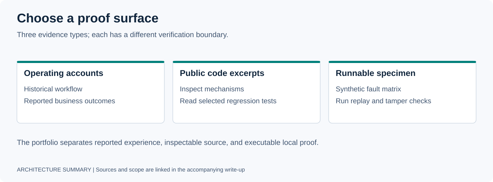

# Evaluate This Portfolio

Start with the deployment story, then reproduce the public proof. This guide is for reviewers, hiring managers, and engineers who want to distinguish reported operating results from behavior they can run themselves.



## Choose Your Review Depth

| Time | Read or run | What to look for |
|---|---|---|
| 3 minutes | [Portfolio](README.md) → [Resume](RESUME.md) | Customer problems, role, and deployment map. |
| 10 minutes | [Lead operations](DEPLOYMENTS/01-real-estate-lead-operations.md) → [Governed execution](DEPLOYMENTS/02-governed-agent-execution.md) → [Field notes](FIELD-NOTES/production-incidents.md) | Integration ownership, failure modes, and the controls they motivated. |
| Technical review | Run the specimen below, then read [Runtime Wind Tunnel](DEPLOYMENTS/03-runtime-wind-tunnel.md) and the [receipt index](receipts/README.md) | Reproducible behavior, evidence provenance, and limits of each claim. |
| Working style | [How I Work](HOW_I_WORK.md) → [Forward Deployed Playbook](PLAYBOOKS/FORWARD_DEPLOYED_PLAYBOOK.md) | Discovery, state ownership, authority, recovery, and platform extraction. |

## Run the Public Wind Tunnel Specimen

Prerequisites: Git and **Python 3.11+**. No API keys, network services, Docker, package installation, or live model provider are needed after cloning.

From a fresh clone:

```bash
git clone https://github.com/gabeacosta/ai-portfolio.git
cd ai-portfolio/specimens/agent-runtime-wind-tunnel
python3 --version  # must be 3.11 or newer
python3 -m unittest discover -s tests -v
python3 -m wind_tunnel demo
python3 -m wind_tunnel tamper
```

If `python3` selects an older version, use an installed Python 3.11+ interpreter for every Python command above. The direct commands avoid requiring Make; `make test`, `make demo`, and `make tamper` are equivalents when Make and a suitable `python3` are available.

Expected demo matrix:

```text
scenario           native       governed
baseline           VERIFIED     VERIFIED
context_reset      VERIFIED     VERIFIED
contradiction      MISMATCH     MISMATCH

6/6 expected verdicts observed
```

The test suite should pass. The contradiction rows deliberately produce `MISMATCH`; those are expected outcomes, not failed demonstrations. The tamper command deliberately corrupts a copied evidence bundle and should print:

```text
Replay verification: FAILED
Reason: EVIDENCE_HASH_MISMATCH
Side effects emitted during replay: 0
```

`tamper` exits successfully when the deliberate corruption is rejected. Each demo writes fresh bundles under the specimen's `evidence/` directory; existing bundles are not overwritten. See the [specimen README](specimens/agent-runtime-wind-tunnel/README.md) for the bundle contract and individual-cell commands.

## What the Evidence Supports

| Surface | Supports | Boundary |
|---|---|---|
| Runnable specimen | Deterministic matrix, declared fault handling, a simulated capability gate, and verification-only replay. | No live-provider benchmark, production policy service, or customer deployment acceptance. |
| Public implementation links | Inspection of the linked repository's published code and tests. | A repository is not a live service health check. |
| Deployment narratives and case studies | Context for reported operating outcomes and architectural choices. | Reported business figures are not independently audited by this specimen. |
| [Receipt index](receipts/README.md) | The public evidence excerpts and provenance disclosed there. | An excerpt is not a complete private evidence corpus or proof of current availability. |
| [Open-source recipes](open-source/README.md) | Inline implementation patterns to inspect and adapt. | README-only recipes, not installed modules or production certification. |

## Questions This Portfolio Should Answer

- What operating problem did Gabe own, and which systems did he integrate?
- What failed, and which architectural control followed?
- Which claims have public code, tests, or disclosed evidence?
- Which result can a reviewer independently reproduce?
- How did field constraints become reusable capability?

[Back to portfolio](README.md) · [How I Work](HOW_I_WORK.md) · [Public specimen](specimens/agent-runtime-wind-tunnel/README.md)
