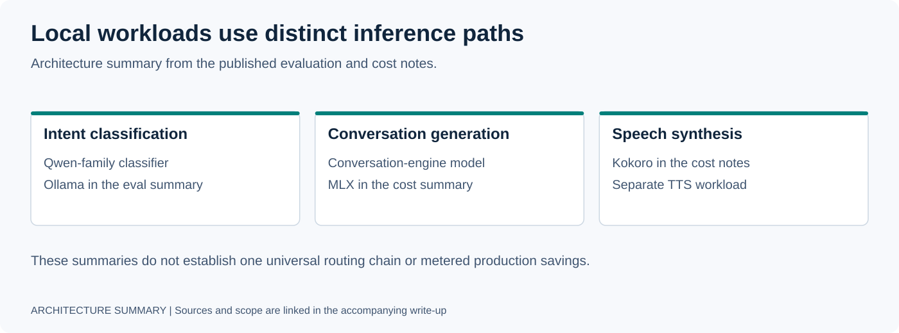
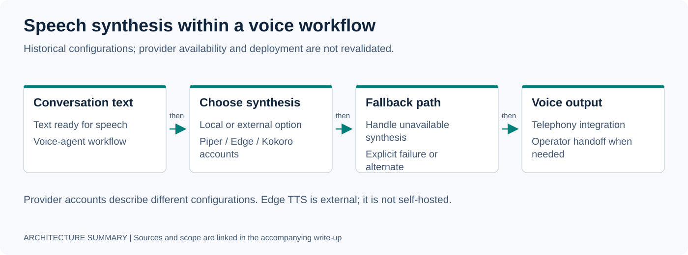
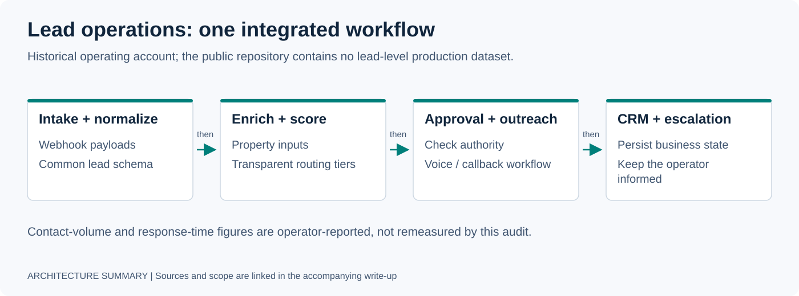
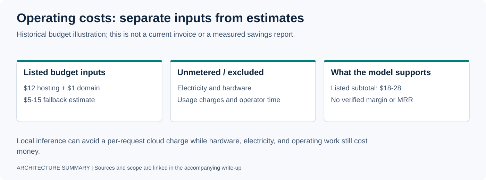
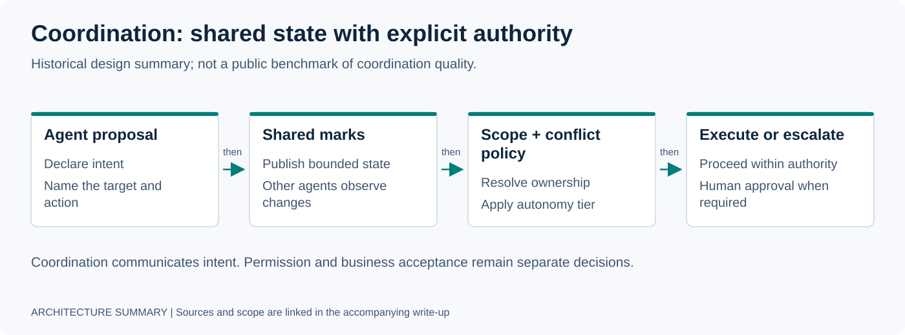
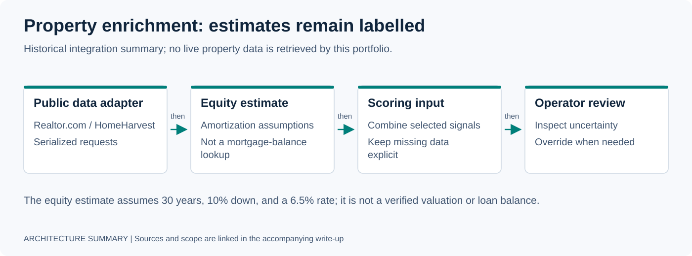

# Case Studies

Six engineering accounts covering local inference, voice, lead operations, cost modeling, agent coordination, and enrichment. Operating figures below are historical reports; the linked public summaries do not establish current service status or independently audited business results.

[Portfolio](README.md) · [Resume](RESUME.md) · [How I work](HOW_I_WORK.md) · [Evidence guide](receipts/README.md)

| Case | Engineering focus | Public material |
|---|---|---|
| [1. Local inference](#case-study-1-replacing-cloud-ai-with-local-inference) | Domain-tuned classification | Evaluation summary and architectural cost model |
| [2. Voice pipeline](#case-study-2-self-hosted-tts-for-multilanguage-voice-agents) | TTS integration and fallback | Historical architecture account |
| [3. Lead operations](#case-study-3-from-manual-lead-qualification-to-automated-routing) | Ingestion through CRM handoff | Deployment account and workflow inventory |
| [4. Operating costs](#case-study-4-modeling-ai-agent-operating-costs) | Fixed versus usage costs | Historical planning estimates |
| [5. Agent coordination](#case-study-5-multi-agent-coordination-with-tiered-autonomy) | Shared state and action approval | Architecture account and related public execution controls |
| [6. Lead enrichment](#case-study-6-property-enrichment-with-public-data-tooling) | Property data and scoring inputs | Reported smoke tests and illustrative score JSON |

## Case Study 1: Replacing Cloud AI with Local Inference

### Challenge and implementation

The original account described voice operations at 100+ calls/week with cloud classification latency around 800 ms–1.2 s and estimated cloud spending of $300–500/month. Those figures are historical reports; no timing trace or billing record is included here.

A Qwen 2.5 1.5B model was fine-tuned with LoRA for a nine-class seller-call intent taxonomy. The [VSAI evaluation summary](receipts/vsai_eval_summary.md) describes **local Ollama inference**, with a cloud mirror as fallback. The separate [cost model](receipts/local_inference_cost_model.md) describes **MLX for conversation-engine inference**. These are distinct workloads, so MLX should not be presented as the measured classifier route.

### Documented result

| Measure | Reported result | Evidence scope |
|---|---|---|
| Held-out cold-set accuracy | 95.5%, then 100% after prefix normalization | Narrative evaluation summary; raw dataset and evaluation output are not published |
| Adversarial-set accuracy | Mid-60s% | Separate, deliberately ambiguous inputs described in the same summary |
| Local classification latency | <200 ms in the original account | No public timing trace; the accuracy summary does not measure latency |
| Inference economics | Local execution avoids a per-request cloud API charge on that path | Architectural model; excludes metered electricity, hardware amortization, and a production invoice comparison |

The useful result is a domain-specific classifier plus a preprocessing correction that closed errors on the reported cold set. It does not establish 100% accuracy on live traffic or a general advantage over larger models.

[Read the lead-operations deployment](DEPLOYMENTS/01-real-estate-lead-operations.md).

## Case Study 2: Self-Hosted TTS for Multilanguage Voice Agents

### Challenge and implementation

The original account projected $200–400/month in cloud TTS charges across English, Spanish, and Chinese calls. This was a planning estimate, not a published bill or a measured saving.

The historical configuration combined Piper, Edge TTS, and espeak fallback, with cross-node routing. Edge TTS depends on an external service; this configuration was not fully self-hosted. The [local inference cost summary](receipts/local_inference_cost_model.md) describes a separate configuration using Kokoro. These accounts should be read as configurations described at different points, not as a verified inventory of today's voice stack.

### Engineering result

The account demonstrates the integration pattern: separate synthesis from call control, choose voices by language, and provide degraded fallback when the preferred path fails. The public material does not include language-quality comparisons, failover traces, or a current availability probe.

Local synthesis removes a metered cloud TTS charge for requests served locally. Hardware, power, operations, telephony, and any external fallback still belong in the operating budget.

For runnable voice-orchestration work, see [VoxMaestro](https://github.com/gabeacosta/voxmaestro).

## Case Study 3: From Manual Lead Qualification to Automated Routing

### Challenge and implementation

A solo real-estate operator reported reviewing 100+ inbound leads/week, spending 5–10 minutes on research per lead, and contacting roughly 40. The pipeline integrated webhook ingestion, normalization, iRELOP scoring, tier routing, voice outreach, callback handling, and HubSpot synchronization.

The [workflow inventory](receipts/n8n_inventory_redacted.md) describes approval checks before outbound communication, along with deduplication and error handling. Routing a lead into an outreach queue is separate from permission to contact that person.

### Historical operating figures

| Metric | Before | Reported automated path |
|---|---|---|
| Leads contacted/week | ~40 | 100+ |
| Time to first contact | 2–48 hours | <15 minutes for hot leads; <2 hours for warm leads |
| Manual qualification | 5–10 min/lead | No manual qualification step on the automated path |
| Uncontacted-lead leakage | ~60% | <5% |

These figures come from the portfolio's operating account. The public inventory explains workflow categories and patterns; it does not contain execution logs, measurement windows, or conversion/revenue attribution for these numbers. Exceptions, approvals, and follow-up can still require operator work.

The reusable design is an explicit lead lifecycle: normalize once, score predictably, route by tier, preserve CRM state, and surface failures for recovery.

[Read the deployment account](DEPLOYMENTS/01-real-estate-lead-operations.md).

## Case Study 4: Modeling AI Agent Operating Costs

### Challenge and approach

The planning question was whether an SMB automation service could support accessible prices with a small infrastructure base. The architecture used owned local compute for suitable workloads and hosted services or cloud APIs where needed.

### Historical budget assumptions

| Cost category | Estimate in the original account |
|---|---|
| Hosting | ~$12/month |
| Domain/SSL allocation | ~$1/month |
| Cloud LLM fallback | ~$5–15/month, dependent on usage |
| Listed hosting, domain, and fallback subtotal | **~$18–28/month** |
| Telephony and voice providers | Variable; outside that subtotal |
| Hardware, electricity, maintenance, support, and other service usage | Not quantified in the account |

The subtotal is arithmetic on historical estimates, not current pricing or a complete cost of service. Self-hosting moves costs into owned infrastructure and operations; it does not make those costs disappear.

The original commercial assumptions listed $1,797/month for Growth Engine, $2,497/month for Lead Recovery, and $50/month for Arachne Claw. They are historical offer assumptions, not a current price list or evidence of paying customers. The $57K MRR figure was a target, not realized revenue.

No margin percentage is established by these inputs. A useful unit-economics model also needs actual usage, customer mix, support effort, hardware allocation, and collected revenue. The [architectural cost summary](receipts/local_inference_cost_model.md) explains the narrower local-inference tradeoff.

## Case Study 5: Multi-Agent Coordination with Tiered Autonomy

### Challenge and implementation

The historical account describes two agents coordinating lead processing, voice calls, and deal analysis. Direct webhook messaging coupled the agents and made conflict handling and action approval difficult to manage.

Markspace used a shared space of intent, action, and observation marks. A Guard checked identity and scope; FIRST_WRITER and HIGHEST_CONFIDENCE policies resolved competing marks. Four autonomy tiers separated lower-risk processing from actions requiring approval. Outbound calls and SMS were described as approval-gated through Telegram.

### Engineering result and public surface

The architecture separates coordination from authorization: agents can share proposed work while a guard controls which effects may proceed. The original account describes PostgreSQL persistence for action marks; this page does not publish a completeness audit or fault/recovery results for that deployment.

Related public execution controls are available in [governed-mcp-spine](https://github.com/gabeacosta/governed-mcp-spine), with context in the [governed execution deployment](DEPLOYMENTS/02-governed-agent-execution.md). That published slice supports inspection of enforcement mechanisms; it does not independently validate the complete Markspace deployment or establish that this coordination approach outperforms alternatives.

## Case Study 6: Property Enrichment with Public Data Tooling

### Challenge and implementation

The lead-scoring pipeline needed property value, ownership, equity, and tax-related inputs. The original account compared a commercial enrichment option estimated at $200+/month with a self-hosted `prop-enricher` service around HomeHarvest.

The service was described as a FastAPI/Docker integration using Realtor.com data through HomeHarvest, with serialized requests. A 30-year amortization model assumed 10% down and a 6.5% interest rate to estimate equity from purchase price. That estimate is a scoring input, not a verified mortgage balance or property valuation.

### Reported smoke-test examples

| Input described in the account | Score | Tier | Reported alert |
|---|---:|---|---|
| Auto-enriched Pahrump, NV lead | 29 | PASS | None |
| Manual tax + pre-foreclosure override | 59 | COOL | None |
| High equity + tax delinquency | 77 | WARM | None |
| Tax + pre-foreclosure + absentee flags | 95 | HOT | Telegram alert reported |

The [score JSON](receipts/score_receipt_example.json) illustrates the WARM example's structure. It is not an execution record or an independently verifiable receipt for a delivered alert. The six markets listed in the original account—NV, AZ, FL, NC, SC, TX—are reported scope, not a validated coverage guarantee.

The integration avoids a paid enrichment API charge for requests it can serve. It still depends on upstream data availability and quality, hosting, and maintenance. The public material does not establish uptime, current source access, metered savings, or a general case against paid data.

## Related systems

### Conversation Engine + iRELOP Lead Scoring

[Case 1](#case-study-1-replacing-cloud-ai-with-local-inference) covers classification and inference boundaries; [Case 3](#case-study-3-from-manual-lead-qualification-to-automated-routing) covers scoring and lead routing. The [deployment account](DEPLOYMENTS/01-real-estate-lead-operations.md) connects the workflow.

### Ceiba Core — Agent Execution Control Plane

The public account of capability checks, scope enforcement, approval boundaries, and audit-chain hardening is the [governed agent execution deployment](DEPLOYMENTS/02-governed-agent-execution.md).

### Arachne Swarm — Multi-Agent Orchestration

[Case 5](#case-study-5-multi-agent-coordination-with-tiered-autonomy) describes the Markspace coordination pattern. For a runnable, deterministic experiment on runtime behavior and evidence verification, see the [Wind Tunnel specimen](specimens/agent-runtime-wind-tunnel/).

[Back to portfolio](README.md) · [Resume](RESUME.md) · [Evidence guide](receipts/README.md)
