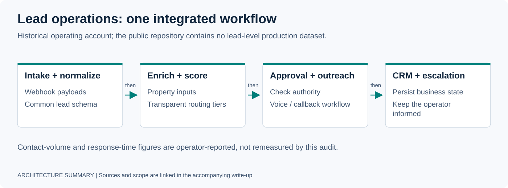

# Deployment 01 — Real-Estate Lead Operations

**Scope:** historical operating account. Outcome figures are operator-reported; this page is not a present-day deployment health check.



## Customer Problem

A solo real-estate operator was receiving 100+ inbound leads per week but manually researching and qualifying each one. The process took roughly 5–10 minutes per lead before outreach, which meant only about 40 leads/week were actually contacted and many aged out before a useful conversation happened.

The operational requirement was not "add AI." It was:

- ingest every lead;
- normalize enough data to make routing decisions;
- identify which leads deserve immediate attention;
- contact the right leads quickly;
- preserve CRM state;
- keep the system inexpensive enough for an SMB operator;
- make failures recoverable without manually checking every workflow.

---

## Discovery

The first-order business constraint was **speed-to-contact**, but that depended on several technical constraints underneath it:

1. lead data arrived from multiple sources and was inconsistent;
2. enrichment could become an expensive recurring API dependency;
3. qualification logic had to be deterministic enough to audit;
4. voice outreach needed low latency and explicit handoff behavior;
5. the CRM needed to remain the durable record of business state;
6. the operator needed escalation for hot leads without babysitting the pipeline.

That turned the problem into a complete operating workflow rather than a chatbot feature.

---

## Technical Scope

The vertical slice became:

```text
lead source
  -> webhook ingestion
  -> normalization
  -> enrichment / scoring inputs
  -> tier decision
  -> outreach / callback path
  -> CRM state update
  -> operator alert / escalation
```

Supporting infrastructure included local inference, fallback routing, TTS, PostgreSQL/Redis-backed state where needed, and workflow automation.

The scoring path used a 100-point iRELOP-style model with three major dimensions:

- motivation;
- opportunity;
- profile.

The purpose was not to create a perfect predictive model. It was to make routing fast, repeatable, and easy to override when new field information arrived.

---

## Integration

### Ingestion and state

Webhook-driven ingestion normalized source-specific lead payloads into a common internal shape before routing. CRM synchronization preserved downstream operator workflow rather than forcing a new source of truth.

### Enrichment

Paid enrichment APIs were evaluated, but for the operating volume the recurring cost was disproportionate. A self-hosted property-enrichment path was built around public data tooling and explicit fallback/override support.

The architectural decision was pragmatic: use enough public/property data to improve early-funnel routing, then reserve higher-cost data for cases where it materially changes the decision.

### Inference

The [VSAI evaluation summary](../receipts/vsai_eval_summary.md) describes a small Qwen-family intent classifier evaluated on local Ollama. It reports 95.5%→100% cold-set accuracy after a prefix-normalizer correction and substantially weaker adversarial results. Raw datasets and evaluation outputs are not public, so this summary cannot independently reproduce that result.

The [cost summary](../receipts/local_inference_cost_model.md) separately associates MLX with conversation-engine inference. These are different workloads and configurations, not evidence of one universal MLX/Ollama fallback chain.

The original account also reports cloud classification at 800 ms–1.2 s and local classification below 200 ms, but the published evaluation summary contains no timing trace. Local execution avoids per-request cloud inference charges on that path; hardware, electricity, operations, and fallback usage remain costs.

### Voice / action path

Voice outreach and callback handling were treated as stateful workflow operations, not isolated model prompts. This work later informed the deterministic state, filler-gate, tool-bridge, and handoff patterns published in [`VoxMaestro`](https://github.com/gabeacosta/voxmaestro).

---

## Historical Reported Outcomes

The portfolio's operating case study reports:

| Metric | Before | After |
|---|---:|---:|
| Leads contacted/week | ~40 | 100+ |
| Hot-lead first contact | 2–48 hours | <15 minutes |
| Manual qualification time | 5–10 min/lead | 0 on automated path |
| Uncontacted lead leakage | ~60% | <5% |
| Local classifier API billing | paid API path | no per-request cloud charge on local path; other costs excluded |

These numbers are operating claims from the portfolio case studies; where a public receipt exists, it is linked directly. This repository does not present every operating metric as independently audited.

---

## What Broke / What Changed

The important engineering lessons were not about model quality alone.

### 1. Cloud-by-default was the wrong cost structure

At SMB volume, repeated classification and TTS calls created recurring costs without improving the core decision enough to justify them. Local-first inference and TTS changed the unit economics and reduced vendor dependence.

### 2. Deterministic routing mattered more than "agent intelligence"

The high-value behavior was getting the right lead onto the right path quickly. A transparent scoring/routing contract was easier to debug and improve than a model making opaque routing decisions.

### 3. Voice required runtime control

Real calls introduced barge-in, dead-air, handoff, tool latency, and escalation problems. Those are orchestration problems, not prompt problems.

### 4. The CRM remained the business system of record

The deployment worked better when AI components adapted to the existing operating system instead of trying to replace it.

---

## Reusable Capabilities Extracted

This deployment fed several reusable platform ideas:

- deterministic lead lifecycle state machines;
- local/cloud inference routing;
- reusable enrichment services;
- voice-agent conversation orchestration;
- operator escalation and approval patterns;
- explicit evidence around automated actions;
- cost-aware model selection.

Public proof surfaces that came from the same class of work include:

- [`voxmaestro`](https://github.com/gabeacosta/voxmaestro);
- [`agentic-crm-os`](https://github.com/gabeacosta/agentic-crm-os);
- [`smart-ai-router`](https://github.com/gabeacosta/smart-ai-router);
- [`receipts/`](../receipts/).

---

## Forward-Deployed Takeaway

The valuable part of this deployment was not any single model. It was owning the full path from a business bottleneck to a functioning operating system:

```text
manual lead bottleneck
  -> measurable service-level requirement
  -> end-to-end workflow
  -> production feedback
  -> cost / reliability hardening
  -> reusable infrastructure
```

That is the pattern I want to repeat in forward deployed engineering roles.

[Back to portfolio](../README.md) · [Next deployment: Governed Agent Execution](02-governed-agent-execution.md)
