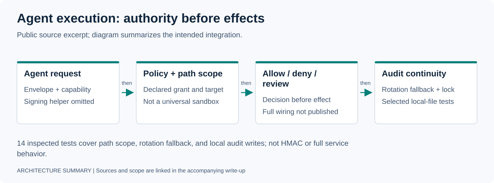

# Deployment 02 — Governed Agent Execution

**Public scope:** inspectable enforcement excerpt. Its published tests cover filesystem scope and selected local audit properties; the full gateway is not independently runnable from this repository.



## Customer / System Problem

Once an AI agent can call tools, the hard problem changes.

The model is no longer only generating text. It can write files, trigger workflows, contact customers, alter business records, spend money, or invoke infrastructure. At that point, "the model decided to do it" is not an acceptable authorization model.

The requirement became:

- authenticate the caller;
- decide whether a capability is allowed;
- constrain where writes may land;
- require approval where consequence is high;
- deny unsafe requests before the effect;
- preserve durable evidence of every allow/deny path;
- keep the evidence chain valid across concurrency and log rotation.

---

## Discovery

The original agent systems already had logs and workflow guards. The failure mode was that those controls were distributed across application code and were easy to bypass, drift, or reinterpret.

The more useful boundary was external to model intent:

```text
agent proposal
  -> authenticated request
  -> policy / capability decision
  -> target-scope check
  -> approval boundary when required
  -> tool execution
  -> durable evidence
```

This made authority an infrastructure concern rather than a prompt convention.

---

## Technical Scope

The public-safe enforcement slice is published as [`governed-mcp-spine`](https://github.com/gabeacosta/governed-mcp-spine).

It includes:

### Signed request envelopes

Requests are canonically serialized and HMAC-signed. The published helper checks a timestamp window. This limits replay age; it is not single-use replay prevention. The gateway references a signing helper that is not included in the public excerpt.

### Capability-based policy

Roles map to explicit capabilities. A request must be authorized for the requested capability before it can proceed.

### Write-scope enforcement

The public helper checks a recognized top-level path field against an optional declared scope. Missing scope or a missing recognized path can permit the request. This is a policy helper, not a universal filesystem sandbox.

### Approval / audit path

The gateway source contains allow/deny audit calls and a separate approval-service path. Public audit delivery is best-effort; the excerpt does not prove durable recording of every decision or a complete end-to-end approval integration.

### Hash-chained evidence

Audit entries include the previous entry hash, creating a tamper-evident chain that can be independently walked and verified.

### Concurrent-write protection

The local audit-file path uses an advisory lock around tail lookup and append. The public concurrency test exercises that lock with a file-only writer; it does not establish cross-host ordering or database-replication correctness.

---

## Production Incident: Rotation Broke the Chain

The original implementation had a subtle evidence defect.

When the audit log rotated and the new file was empty, the writer initialized `previous_hash` to a sentinel instead of recovering the last durable hash from the prior chain. That meant the apparent hash chain silently restarted after rotation.

The public repo documents that roughly 60% of audit entries in the affected deployment were anchored to the sentinel rather than one continuous chain.

This mattered because a "tamper-evident" log is only meaningful if it is actually one chain. Resetting the anchor weakened the property the system claimed to provide.

### Fix

The tested fallback recovers the database tail when the active file is empty. The implementation can still return `GENESIS` on a database exception, so this is not an unconditional continuity guarantee. Regression tests cover:

- rotation with prior history must continue the chain;
- a genuinely fresh system with no history may start a new chain.

The incident moved the system from an architectural claim to a property backed by a concrete failure and a regression test.

---

## Public Verification Surface

The published suite contains **14 test functions**, inspected during the 2026-10-30 portfolio audit:

- 10 write-scope tests;
- 2 rotation-fallback tests;
- 2 serial/concurrent audit-file tests.

The concurrent test uses 10 threads × 100 writes with a file-only replacement for the audit writer. The signing and role/capability behaviors described in source are not covered by these 14 tests. The portfolio audit inspected these sources; it did not rerun the spine suite or verify a live service.

Public source references: [tests](https://github.com/gabeacosta/governed-mcp-spine/tree/master/tests), [concurrency test](https://github.com/gabeacosta/governed-mcp-spine/blob/master/tests/test_toctou_concurrent.py), [shared helpers](https://github.com/gabeacosta/governed-mcp-spine/blob/master/shared/common.py), and [gateway excerpt](https://github.com/gabeacosta/governed-mcp-spine/blob/master/services/policy-gateway/src/main.py).

The repo intentionally excludes tenant business data, real infrastructure wiring, proprietary policies, the full orchestrator, and production-specific identifiers.

That boundary matters: public proof should demonstrate the mechanism without pretending the redacted slice is the entire production system.

---

## What This Changed Architecturally

The deployment established a stronger separation of concerns:

```text
model / agent
  proposes
      |
      v
runtime / orchestrator
  coordinates
      |
      v
authority boundary
  permits or denies
      |
      v
effect sink
  changes the world
      |
      v
evidence / verifier
  proves what happened
```

The model does not own permission. The runtime does not get to silently reinterpret policy. The audit path does not get to claim integrity without verification.

---

## Reusable Capabilities Extracted

This work produced primitives that apply beyond one agent deployment:

- capability-based tool authorization;
- scoped write boundaries;
- approval-gated external effects;
- canonical signed envelopes;
- replay-window checks;
- hash-chained decision evidence;
- concurrency-safe evidence writes;
- independent chain verification.

Those primitives now inform broader Veynit work around governed execution and effect verification.

---

## Forward-Deployed Takeaway

The field lesson was not "agents need more guardrails." It was more specific:

> Any system that lets probabilistic components produce real-world effects needs a deterministic authority boundary with evidence that survives operational failure.

The forward-deployed value is recognizing that requirement while integrating the customer workflow, then extracting it into an infrastructure primitive that can serve more than one deployment.

[Back to portfolio](../README.md) · [Previous: Real-Estate Lead Operations](01-real-estate-lead-operations.md) · [Next: Runtime Wind Tunnel](03-runtime-wind-tunnel.md)
