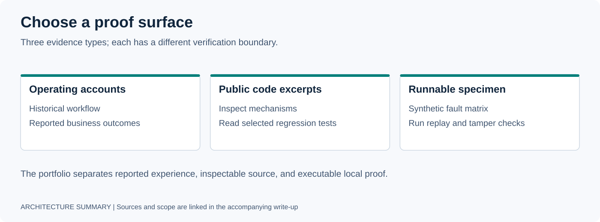
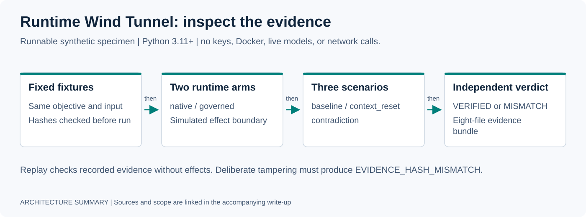

# Gabe Acosta | Applied AI & Agent Systems

I build AI-enabled operating workflows and the infrastructure that makes them observable, bounded, and recoverable. My work spans voice agents, business integrations, local inference, authorization, and runtime verification.

**Focus:** Forward Deployed Engineer / Forward Deployed AI Engineer roles.

[Resume](RESUME.md) · [Review guide](APPLY.md) · [Case studies](CASE_STUDIES.md) · [How I work](HOW_I_WORK.md) · [Contact](#contact)

## Start here



This portfolio contains historical operating accounts, extracted public code, and a runnable local specimen. Diagrams summarize documented designs; they are not live dashboards or application screenshots.

| Start with | What you can assess | Evidence boundary |
| --- | --- | --- |
| [Real-estate lead operations](DEPLOYMENTS/01-real-estate-lead-operations.md) | Workflow discovery, integration decisions, voice outreach, and CRM state | Historical operator-reported outcomes; no public lead-level production dataset |
| [Governed agent execution](DEPLOYMENTS/02-governed-agent-execution.md) | Write-scope enforcement and audit-chain rotation/concurrency behavior | Public source excerpt with selected regression tests; full gateway dependencies are not published |
| [Runtime Wind Tunnel](DEPLOYMENTS/03-runtime-wind-tunnel.md) | Controlled faults, independent verdicts, durable recovery, and tamper detection | Runnable synthetic specimen; no live model, provider, or production integration |

## Runnable proof: Runtime Wind Tunnel



The [public specimen](specimens/agent-runtime-wind-tunnel/) runs locally with **Python 3.11+**, using only the standard library. It needs no API keys, Docker, model downloads, or network calls after cloning.

```bash
git clone https://github.com/gabeacosta/ai-portfolio.git
cd ai-portfolio/specimens/agent-runtime-wind-tunnel
python3 -m unittest discover -s tests -v
python3 -m wind_tunnel demo
python3 -m wind_tunnel tamper
```

Expected demo matrix:

```text
scenario           native       governed
baseline           VERIFIED     VERIFIED
context_reset      VERIFIED     VERIFIED
contradiction      MISMATCH     MISMATCH
```

The contradiction result is intentional. The tamper demonstration reports `FAILED / EVIDENCE_HASH_MISMATCH`; its command exits successfully when that expected rejection is detected. Directly verifying a corrupted bundle exits with an error.

**Rechecked 2026-10-30:** 14 specimen tests passed, all six matrix cells matched their expected verdicts, and the tamper check rejected altered evidence. [Audit scope and findings](docs/PORTFOLIO_AUDIT.md).

## Selected work

### Real-estate lead operations

The documented workflow connects ingestion, normalization, enrichment, deterministic scoring, approved outreach, CRM state, and operator escalation. It shows how a business bottleneck becomes a complete integration problem.

The historical case study reports an increase from roughly 40 to 100+ leads contacted per week and hot-lead contact below 15 minutes. Those are operator-reported figures; this repository does not independently verify them or establish current live service status.

[Deployment account and diagram](DEPLOYMENTS/01-real-estate-lead-operations.md) · [Historical case studies](CASE_STUDIES.md)

### Governed agent execution

The [public enforcement excerpt](https://github.com/gabeacosta/governed-mcp-spine) exposes filesystem write boundaries and audit-chain handling. Its 14 checked-in tests cover write scope, rotation fallback, and serial/concurrent local audit-file writes.

The gateway source also describes capability and signed-envelope integration, but it references an unpublished signing helper. It is an inspectable slice; the public tests do not cover the full gateway or establish the private service's present deployment.

[Scope, incident, and diagram](DEPLOYMENTS/02-governed-agent-execution.md)

### Runtime Wind Tunnel

The public specimen holds fixtures constant across native and governed arms, injects explicit faults, recovers transient state from durable storage, and verifies evidence without replaying effects. Each run emits an eight-file evidence bundle.

It tests a synthetic runtime contract. It does not benchmark model quality or establish the current behavior of the private Runtime Lab implementation.

[Run the specimen](specimens/agent-runtime-wind-tunnel/) · [Experiment design](DEPLOYMENTS/03-runtime-wind-tunnel.md)

## Public project map

| Project | Public surface |
| --- | --- |
| [VoxMaestro](https://github.com/gabeacosta/voxmaestro) | Alpha voice-orchestration source with an early Pipecat adapter; production telephony transports are outside this public surface |
| [Governed MCP Spine](https://github.com/gabeacosta/governed-mcp-spine) | Enforcement excerpt; selected filesystem-scope and local audit regression tests |
| [Wind Tunnel specimen](specimens/agent-runtime-wind-tunnel/) | Dependency-free controlled-fault and evidence-verification demo |
| [Clue Runtime](https://github.com/gabeacosta/clue-runtime) | Two extracted readiness/startup-drift reliability modules |
| [MCP Audit Plugin](https://github.com/gabeacosta/mcp-audit-plugin) | MCP configuration diagnostic prototype |
| [Agentic CRM OS](https://github.com/gabeacosta/agentic-crm-os) | PostgreSQL schema and lead-state machine with row locking; not a complete application |
| [Smart AI Router](https://github.com/gabeacosta/smart-ai-router) | Explicitly incomplete request-routing scaffold |
| [LeadFlow](https://github.com/gabeacosta/leadflow-python-automation) | Local deterministic lead-qualification demo with an inline walkthrough |
| [Reference recipes](open-source/) | Inline code examples for provider fallback and conversation-state tracking |
| [Evidence summaries](receipts/) | Narrative summaries and an illustrative scoring record; not independently signed production receipts |

Public code and tests demonstrate their stated scope. A repository link alone does not establish a complete integration or a running service.

## How I work

```text
Discover → Scope → Build → Integrate → Observe → Evaluate → Harden → Extract
```

I start with the operating constraint, ship a useful vertical slice, instrument its failure paths, and extract reusable infrastructure when the field implementation justifies it.

- Make authority, approval, write scope, and side effects explicit.
- Separate provider output from verifier acceptance.
- Reproduce incidents and turn them into regression coverage.
- Keep reported outcomes distinct from reproducible public evidence.

[Operating approach](HOW_I_WORK.md) · [Field playbook](PLAYBOOKS/FORWARD_DEPLOYED_PLAYBOOK.md) · [Historical incident notes](FIELD-NOTES/production-incidents.md)

## Evidence standard

**Implemented** means code exists. **Tested** means named checks ran. **Verified** means evidence supports a stated property. **Accepted** means the designated gate authorized the result. **Deployed** describes operation in an intended environment at the documented time.

Historical deployment accounts do not imply present availability. The 2026-10-30 audit checks this public portfolio and its local specimen; it does not inspect private infrastructure, remeasure customer outcomes, or certify security. Customer data, credentials, proprietary policies, and private implementation details remain outside this repository.

## Contact

- GitHub: [github.com/gabeacosta](https://github.com/gabeacosta)
- Email: gabriel@gentic.pro
- Focus: applied AI, voice systems, governed agent execution, runtime reliability, and business automation
