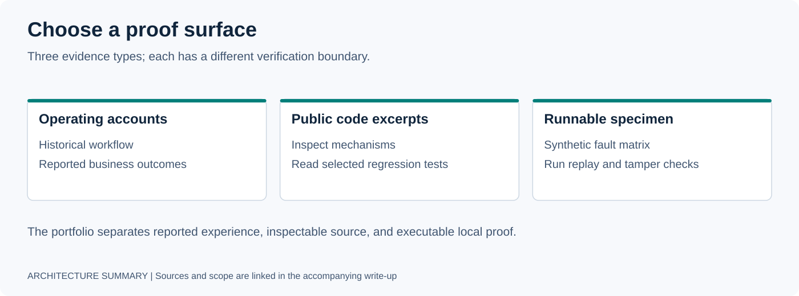

# Open-Source Recipes

Two implementation patterns for provider fallback and conversation state. These directories contain **README-only code recipes**: the Python is inline below each explanation, with no checked-in importable module, package, or automated test suite for these recipes.

## Choose a Recipe

| Recipe | Pattern | Prerequisites |
|---|---|---|
| [LLM Fallback Router](llm-fallback-router/README.md) | Priority routing, failure cooldown, and per-provider latency statistics. | Python 3.11+, `httpx`, and configured provider endpoints; external calls may incur cost. |
| [Conversation State Tracker](conversation-state-tracker/README.md) | Explicit question coverage, supplied evasion/emotion labels, and per-turn directives. | Python 3.11+, standard library only; the demo uses manually supplied events. |

To try a recipe, save its named implementation block to a local Python file and follow that page's setup. An import such as `from llm_router import LLMRouter` works only after you create that file.

## Scope and Reuse

The recipes illustrate patterns motivated by deployment work. They do not establish that these exact snippets are currently deployed, production-tested, or sufficient for a production service.

They favor small interfaces and few dependencies. Before adopting them, validate inputs, adapt the policy and error handling to your workload, and test the integrations and failure paths you rely on. The [MIT license](../LICENSE) covers the published material.

For an executable proof already checked into this repository, start with the [Runtime Wind Tunnel specimen](../specimens/agent-runtime-wind-tunnel/README.md) or the [review guide](../APPLY.md).

[Back to portfolio](../README.md)
