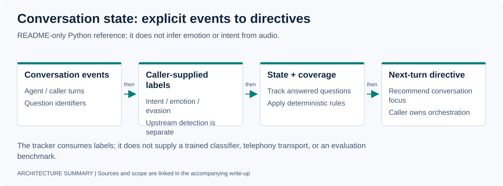

# Conversation State Tracker

Track explicit question coverage and generate a next-turn directive from caller-supplied conversation events.

**Status: README-only recipe.** Save the implementation below as `state_tracker.py` to run its deterministic demo with `python3 state_tracker.py`. Python 3.11+ is required; the recipe uses only the standard library. No checked-in module, package, transcript classifier, or recipe test suite is included.



## The Problem This Illustrates

A conversational model can repeat questions or lose track of coverage. This recipe keeps question status outside the model and selects a directive from that state. It does not listen to audio, parse transcripts, detect evasion, or infer emotion. A separate application or classifier must supply those labels.

## Turn Contract

1. Create one tracker per conversation with stable question IDs.
2. Call `generate_directive()` and pass the result to your model integration.
3. When a question is actually asked, call `record_ask(question_id)`.
4. After interpreting the response, call `record_answer(...)` or `record_evasion(...)`; call `update_emotion(...)` only with an externally supplied label.
5. Call `advance_turn()`, then generate the next directive.

An `ASKED` question is awaiting interpretation and is excluded from the pending list. Resolve it before generating the next question. A generated directive does not itself record that the model asked it or prove that the model followed it.

## `state_tracker.py`

```python
"""
Conversation State Tracker
Tracks coverage and supplied evasion/emotion labels across multi-turn conversations.
Generates inline directives for AI-guided dialogue.

MIT License
"""

from dataclasses import dataclass
from enum import Enum
from typing import Optional


class QuestionStatus(Enum):
    PENDING = "pending"
    ASKED = "asked"
    ANSWERED = "answered"
    EVADED = "evaded"


class EmotionalState(Enum):
    NEUTRAL = "neutral"
    COOPERATIVE = "cooperative"
    HESITANT = "hesitant"
    FRUSTRATED = "frustrated"
    EMOTIONAL = "emotional"
    HOSTILE = "hostile"


@dataclass
class Question:
    id: str
    text: str
    priority: str  # "core" or "tail"
    status: QuestionStatus = QuestionStatus.PENDING
    ask_count: int = 0
    evasion_count: int = 0
    answer: Optional[str] = None

    @property
    def is_core(self) -> bool:
        return self.priority == "core"

    @property
    def needs_attention(self) -> bool:
        return self.status in (QuestionStatus.PENDING, QuestionStatus.EVADED)


@dataclass
class ConversationState:
    questions: list[Question]
    emotional_state: EmotionalState = EmotionalState.NEUTRAL
    turn_count: int = 0
    evasion_streak: int = 0
    rapport_score: float = 0.5  # 0.0 = hostile, 1.0 = fully cooperative

    @property
    def coverage(self) -> float:
        """Fraction of questions answered (0.0 to 1.0)."""
        if not self.questions:
            return 0.0
        answered = sum(1 for q in self.questions if q.status == QuestionStatus.ANSWERED)
        return answered / len(self.questions)

    @property
    def core_coverage(self) -> float:
        """Fraction of core questions answered (0.0 to 1.0)."""
        core = [q for q in self.questions if q.is_core]
        if not core:
            return 0.0
        answered = sum(1 for q in core if q.status == QuestionStatus.ANSWERED)
        return answered / len(core)

    @property
    def pending_core(self) -> list[Question]:
        return [q for q in self.questions if q.is_core and q.needs_attention]

    @property
    def pending_tail(self) -> list[Question]:
        return [q for q in self.questions if not q.is_core and q.needs_attention]


class StateTracker:
    def __init__(self, questions: list[dict]):
        """
        Initialize with a list of question definitions.

        questions: [{"id": "price", "text": "What price are you hoping for?", "priority": "core"}, ...]
        """
        self.state = ConversationState(
            questions=[
                Question(id=q["id"], text=q["text"], priority=q.get("priority", "tail"))
                for q in questions
            ]
        )

    def record_ask(self, question_id: str):
        """Record that a question was asked."""
        q = self._find_question(question_id)
        if q:
            q.status = QuestionStatus.ASKED
            q.ask_count += 1

    def record_answer(self, question_id: str, answer: str):
        """Record that a question was answered."""
        q = self._find_question(question_id)
        if q:
            q.status = QuestionStatus.ANSWERED
            q.answer = answer
            self.state.evasion_streak = 0
            self.state.rapport_score = min(1.0, self.state.rapport_score + 0.05)

    def record_evasion(self, question_id: str):
        """Record that the caller evaded a question."""
        q = self._find_question(question_id)
        if q:
            q.status = QuestionStatus.EVADED
            q.evasion_count += 1
            self.state.evasion_streak += 1
            self.state.rapport_score = max(0.0, self.state.rapport_score - 0.1)

    def update_emotion(self, state: EmotionalState):
        """Store an emotional-state label supplied by the calling application."""
        self.state.emotional_state = state

    def advance_turn(self):
        """Increment turn counter."""
        self.state.turn_count += 1

    def generate_directive(self) -> str:
        """
        Generate an inline directive for the AI model.
        The calling application passes this to its model integration.
        Generation alone does not record that a question was asked.
        """
        state = self.state

        # Hostile → de-escalate
        if state.emotional_state == EmotionalState.HOSTILE:
            return (
                "YOUR NEXT STEP: The caller is hostile. Do NOT push for information. "
                "De-escalate with empathy. If they remain hostile, offer to call back "
                "at a better time."
            )

        # High evasion → acknowledge and try softer approach
        if state.evasion_streak >= 2:
            next_q = self._pick_next_question(soft=True)
            if next_q:
                return (
                    f"YOUR NEXT QUESTION: The caller has been hesitant. "
                    f"Acknowledge their concern, then gently ask: {next_q.text} "
                    f"Frame it as helping them get the best outcome."
                )

        # Emotional caller → empathize first
        if state.emotional_state in (EmotionalState.EMOTIONAL, EmotionalState.FRUSTRATED):
            next_q = self._pick_next_question(soft=True)
            directive = "YOUR NEXT STEP: The caller is emotional. Validate their feelings first. "
            if next_q:
                directive += f"When ready, transition to: {next_q.text}"
            return directive

        # Normal flow → ask next pending question
        next_q = self._pick_next_question()
        if next_q:
            return f"YOUR NEXT QUESTION: {next_q.text}"

        # All questions covered
        if state.core_coverage >= 0.8:
            return (
                "YOUR NEXT STEP: Core questions are covered. "
                "Summarize what you've learned and transition to the value proposition."
            )

        return "YOUR NEXT STEP: Continue the conversation naturally."

    def get_summary(self) -> dict:
        """Return a snapshot of conversation state."""
        return {
            "turn_count": self.state.turn_count,
            "coverage": round(self.state.coverage * 100, 1),
            "core_coverage": round(self.state.core_coverage * 100, 1),
            "emotional_state": self.state.emotional_state.value,
            "evasion_streak": self.state.evasion_streak,
            "rapport_score": round(self.state.rapport_score, 2),
            "questions": {
                q.id: {
                    "status": q.status.value,
                    "ask_count": q.ask_count,
                    "evasion_count": q.evasion_count,
                    "answered": q.answer is not None,
                }
                for q in self.state.questions
            },
        }

    # --- Internal ---

    def _find_question(self, question_id: str) -> Optional[Question]:
        for q in self.state.questions:
            if q.id == question_id:
                return q
        return None

    def _pick_next_question(self, soft: bool = False) -> Optional[Question]:
        """
        Pick the next question to ask.
        Priority: core pending > core evaded > tail pending > tail evaded
        If soft=True, prefer questions that haven't been evaded multiple times.
        """
        candidates = []

        # Core pending first
        candidates.extend(
            sorted(
                [q for q in self.state.pending_core if q.status == QuestionStatus.PENDING],
                key=lambda q: q.ask_count,
            )
        )

        # Core evaded (retry)
        candidates.extend(
            sorted(
                [q for q in self.state.pending_core if q.status == QuestionStatus.EVADED],
                key=lambda q: q.evasion_count,
            )
        )

        # Tail questions
        candidates.extend(
            sorted(
                self.state.pending_tail,
                key=lambda q: (q.evasion_count, q.ask_count),
            )
        )

        if soft:
            # Prefer less-evaded questions; fall back to candidates if none remain
            candidates = [q for q in candidates if q.evasion_count < 2] or candidates

        return candidates[0] if candidates else None


# --- Demo ---
if __name__ == "__main__":
    # Define qualification questions
    questions = [
        {"id": "price", "text": "What price are you hoping to get?", "priority": "core"},
        {"id": "motivation", "text": "What's driving the decision to sell?", "priority": "core"},
        {"id": "timeline", "text": "What's your ideal timeline?", "priority": "core"},
        {"id": "condition", "text": "How would you describe the property's condition?", "priority": "core"},
        {"id": "agent", "text": "Are you currently working with an agent?", "priority": "core"},
        {"id": "decision_maker", "text": "Is there anyone else involved in the decision?", "priority": "tail"},
    ]

    tracker = StateTracker(questions)

    # Simulate a conversation
    print("Turn 1:", tracker.generate_directive())

    tracker.record_ask("price")
    tracker.record_answer("price", "Around 350k")
    tracker.advance_turn()

    print("Turn 2:", tracker.generate_directive())

    tracker.record_ask("motivation")
    tracker.record_evasion("motivation")  # Application supplies the evasion label
    tracker.advance_turn()

    print("Turn 3:", tracker.generate_directive())

    tracker.record_evasion("motivation")  # Simulated second evasion
    tracker.update_emotion(EmotionalState.HESITANT)
    tracker.advance_turn()

    print("Turn 4:", tracker.generate_directive())

    print("\nSummary:", tracker.get_summary())
```

## What the Recipe Demonstrates

The demo supplies synthetic answers and evasion labels, then prints the resulting directives and summary. Coverage is derived from explicit answered statuses; `get_summary()` expresses it as a percentage. The rapport score is a hand-written heuristic, not a validated measurement of a caller's feelings.

No transcript dataset, scoring rubric, or reproducible model benchmark accompanies this recipe, so it makes no numerical claim about conversation quality or question coverage in live calls. Model compliance with a directive must be evaluated separately.

## Limits to Address Before Adoption

- State is in memory. Persistence, restart recovery, session isolation, and concurrent updates belong to the integrating application.
- Unknown question IDs are silently ignored, and duplicate IDs are not rejected. Validate definitions and event IDs at the boundary.
- Supplied labels can be wrong. Repeated evasion invokes a softer directive, but the question picker can revisit repeatedly evaded questions if no alternatives remain. Add your own consent, stop, and retry policy.
- Directive generation does not enforce model behavior or authorize calls, messages, CRM writes, or other external effects.
- The demo does not implement transcription, classification, model calls, telephony, or a handoff integration.

[Back to Open-Source Recipes](../README.md) · [Portfolio](../../README.md)
