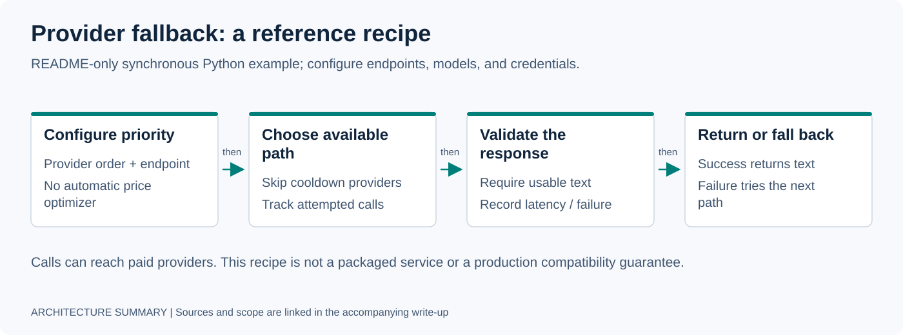

# LLM Fallback Router

Priority-ordered provider fallback with a per-provider failure cooldown and latency statistics.

**Status: README-only recipe.** This directory does not contain an importable `llm_router.py`, package, or recipe test suite. Save the implementation block below as `llm_router.py` before using the import example. Deployment work motivated the pattern; this page does not establish that this exact snippet is production-tested or currently deployed.



## Why This Exists

A provider outage or rate limit can interrupt a workflow. This recipe tries explicitly configured providers in priority order and temporarily skips providers after repeated failures. It does not select by price, quality, or observed latency.

## Prerequisites

Use Python 3.11+ and install `httpx` in a virtual environment:

```bash
python3 -m venv .venv
. .venv/bin/activate
python3 -m pip install httpx
```

Choose endpoints and models supported by your providers. Each configuration requires `base_url` and `model`; this recipe does not discover endpoints or credentials. Requests can incur provider charges. Keep credentials in environment variables and out of source files.

## Usage

After saving the implementation as `llm_router.py`, set `LLM_PRIMARY_BASE_URL`, `LLM_PRIMARY_MODEL`, `LLM_FALLBACK_BASE_URL`, and `LLM_FALLBACK_MODEL` in your shell. For OpenAI-compatible endpoints, each base URL must include its API prefix (often `/v1`) because the recipe appends `/chat/completions`. Optional keys come from `LLM_PRIMARY_API_KEY` and `LLM_FALLBACK_API_KEY`.

```python
import os

from llm_router import LLMRouter

router = LLMRouter([
    {
        "provider": "primary",
        "base_url": os.environ["LLM_PRIMARY_BASE_URL"],
        "model": os.environ["LLM_PRIMARY_MODEL"],
        "api_key": os.environ.get("LLM_PRIMARY_API_KEY"),
        "priority": 1,
    },
    {
        "provider": "fallback",
        "base_url": os.environ["LLM_FALLBACK_BASE_URL"],
        "model": os.environ["LLM_FALLBACK_MODEL"],
        "api_key": os.environ.get("LLM_FALLBACK_API_KEY"),
        "priority": 2,
    },
])

response = router.complete(
    messages=[{"role": "user", "content": "Classify this intent..."}],
    max_tokens=200,
    timeout=5.0,
)

print(response.text)
print(response.provider_used)   # Provider that returned successfully
print(response.latency_ms)      # Successful attempt only, not total failover time
print(response.fallback_count)  # Failed or cooldown-skipped entries before success
```

For the Anthropic branch, the provider name must contain `anthropic`, the base URL must be the API origin without `/v1` (the recipe appends `/v1/messages`), and messages must use that API's supported user/assistant format. System instructions require adaptation to its separate system field; they are not translated here. Provider-specific features, streaming, and tool calls are outside this recipe.

---

## `llm_router.py`

```python
"""
LLM Fallback Router
Multi-provider LLM routing with automatic failover and latency tracking.

MIT License
"""

import time
import json
import logging
from dataclasses import dataclass, field
from typing import Optional

import httpx

logger = logging.getLogger(__name__)


@dataclass
class LLMResponse:
    text: str
    provider_used: str
    model_used: str
    latency_ms: float
    fallback_count: int
    raw: dict = field(default_factory=dict)


@dataclass
class ProviderConfig:
    name: str
    base_url: str
    model: str
    priority: int
    api_key: Optional[str] = None
    headers: dict = field(default_factory=dict)
    consecutive_failures: int = 0
    cooldown_until: float = 0.0
    avg_latency_ms: float = 0.0
    total_calls: int = 0

    # Circuit breaker settings
    max_failures: int = 3
    cooldown_seconds: float = 60.0

    @property
    def is_available(self) -> bool:
        if self.consecutive_failures >= self.max_failures:
            if time.time() < self.cooldown_until:
                return False
            # Cooldown expired, allow retry
            self.consecutive_failures = 0
        return True

    def record_success(self, latency_ms: float):
        self.consecutive_failures = 0
        self.total_calls += 1
        # Exponential moving average
        alpha = 0.3
        if self.avg_latency_ms == 0:
            self.avg_latency_ms = latency_ms
        else:
            self.avg_latency_ms = alpha * latency_ms + (1 - alpha) * self.avg_latency_ms

    def record_failure(self):
        self.consecutive_failures += 1
        if self.consecutive_failures >= self.max_failures:
            self.cooldown_until = time.time() + self.cooldown_seconds
            logger.warning(
                f"Provider {self.name} circuit breaker OPEN "
                f"(cooldown {self.cooldown_seconds}s)"
            )


class LLMRouter:
    def __init__(self, providers: list[dict], default_timeout: float = 10.0):
        self.providers = []
        self.default_timeout = default_timeout

        for p in sorted(providers, key=lambda x: x.get("priority", 99)):
            config = ProviderConfig(
                name=p.get("provider", p.get("name", "unknown")),
                base_url=p["base_url"].rstrip("/"),
                model=p["model"],
                priority=p.get("priority", 99),
                api_key=p.get("api_key"),
                headers=dict(p.get("headers", {})),
                max_failures=p.get("max_failures", 3),
                cooldown_seconds=p.get("cooldown_seconds", 60.0),
            )

            # Build auth headers
            if config.api_key:
                if "anthropic" in config.name.lower():
                    config.headers["x-api-key"] = config.api_key
                    config.headers["anthropic-version"] = "2023-06-01"
                else:
                    config.headers["Authorization"] = f"Bearer {config.api_key}"

            config.headers["Content-Type"] = "application/json"
            self.providers.append(config)

    def complete(
        self,
        messages: list[dict],
        max_tokens: int = 500,
        temperature: float = 0.0,
        timeout: Optional[float] = None,
        required_provider: Optional[str] = None,
    ) -> LLMResponse:
        """
        Route a completion request through the provider chain.
        Falls through to next provider on any failure.
        """
        timeout = timeout or self.default_timeout
        fallback_count = 0
        errors = []

        candidates = self.providers
        if required_provider:
            candidates = [p for p in self.providers if p.name == required_provider]
            if not candidates:
                raise ValueError(f"Provider '{required_provider}' not found")

        for provider in candidates:
            if not provider.is_available:
                logger.debug(f"Skipping {provider.name} (circuit breaker open)")
                fallback_count += 1
                continue

            try:
                start = time.perf_counter()
                response = self._call_provider(
                    provider, messages, max_tokens, temperature, timeout
                )
                latency_ms = (time.perf_counter() - start) * 1000

                provider.record_success(latency_ms)

                return LLMResponse(
                    text=response["text"],
                    provider_used=provider.name,
                    model_used=provider.model,
                    latency_ms=round(latency_ms, 1),
                    fallback_count=fallback_count,
                    raw=response.get("raw", {}),
                )

            except Exception as e:
                provider.record_failure()
                fallback_count += 1
                errors.append(f"{provider.name}: {type(e).__name__}")
                logger.warning("Provider %s failed (%s)", provider.name, type(e).__name__)
                continue

        raise RuntimeError(
            f"All providers exhausted. Errors:\n" + "\n".join(errors)
        )

    def _call_provider(
        self,
        provider: ProviderConfig,
        messages: list[dict],
        max_tokens: int,
        temperature: float,
        timeout: float,
    ) -> dict:
        """Make the actual API call. Handles OpenAI and Anthropic formats."""

        is_anthropic = "anthropic" in provider.name.lower()

        if is_anthropic:
            # Anthropic Messages API format
            body = {
                "model": provider.model,
                "max_tokens": max_tokens,
                "temperature": temperature,
                "messages": messages,
            }
            endpoint = f"{provider.base_url}/v1/messages"
        else:
            # OpenAI-compatible format (works for local, xAI, Google, etc.)
            body = {
                "model": provider.model,
                "max_tokens": max_tokens,
                "temperature": temperature,
                "messages": messages,
            }
            endpoint = f"{provider.base_url}/chat/completions"

        with httpx.Client(timeout=timeout) as client:
            resp = client.post(endpoint, headers=provider.headers, json=body)
            resp.raise_for_status()
            data = resp.json()

        # This text-only recipe treats missing or empty text as a failed attempt.
        if is_anthropic:
            text = "".join(
                block["text"] for block in data["content"] if block.get("type") == "text"
            )
        else:
            text = data["choices"][0]["message"]["content"]
        if not isinstance(text, str) or not text.strip():
            raise ValueError("Provider returned no text")

        return {"text": text, "raw": data}

    def get_stats(self) -> list[dict]:
        """Return provider health stats."""
        return [
            {
                "name": p.name,
                "model": p.model,
                "priority": p.priority,
                "available": p.is_available,
                "avg_latency_ms": round(p.avg_latency_ms, 1),
                "total_calls": p.total_calls,
                "consecutive_failures": p.consecutive_failures,
            }
            for p in self.providers
        ]


# --- Quick test ---
if __name__ == "__main__":
    # Example: local-only setup
    router = LLMRouter([
        {
            "provider": "primary_local",
            "base_url": "http://127.0.0.1:8000/v1",  # illustrative; configure your service
            "model": "qwen2.5:1.5b",
            "priority": 1,
        },
        {
            "provider": "ollama_local",
            "base_url": "http://127.0.0.1:11434/v1",  # requires a running local provider
            "model": "qwen2.5:1.5b",
            "priority": 2,
        },
    ])

    try:
        result = router.complete(
            messages=[{"role": "user", "content": "Say hello in one word."}],
            max_tokens=10,
        )
        print(f"Response: {result.text}")
        print(f"Provider: {result.provider_used}")
        print(f"Latency: {result.latency_ms}ms")
    except RuntimeError as e:
        print(f"All providers failed: {e}")

    print("\nProvider stats:", json.dumps(router.get_stats(), indent=2))
```

## What the Recipe Covers

- **Priority routing** — first successful text response wins.
- **Failure cooldown** — in-memory counters skip a provider after repeated failures.
- **Latency statistics** — an exponential moving average of successful calls per provider.
- **Two request shapes** — a basic OpenAI-compatible chat request or Anthropic Messages request.
- **Provider pinning** — `required_provider` restricts candidates to the named provider.

## Limits to Address Before Adoption

- `timeout` is passed to each HTTP attempt; it is not a total failover deadline. Multiple failures can exceed the caller's overall latency budget.
- All exceptions count as provider failures, including malformed responses, configuration errors, and authentication failures. This is not a retry classification policy.
- Circuit state lives in one Python object. It is not persisted, shared across processes, or protected for concurrent callers; it does not implement a coordinated half-open probe.
- A new HTTP client is opened for each attempt. No streaming, cancellation, connection-pool lifecycle, rate-limit backoff, or idempotency contract is provided.
- Exception logs contain the provider name and exception class only. Do not add raw request, response, URL, or credential logging without a sanitization policy. `raw` retains the provider response in memory.
- Test your provider's current request/response schema and the entire failure path before relying on this recipe. No live-provider compatibility or latency target is demonstrated here.

For a checked-in runnable harness with deterministic failure tests, see the [Wind Tunnel specimen](../../specimens/agent-runtime-wind-tunnel/README.md).

[Back to Open-Source Recipes](../README.md) · [Portfolio](../../README.md)
