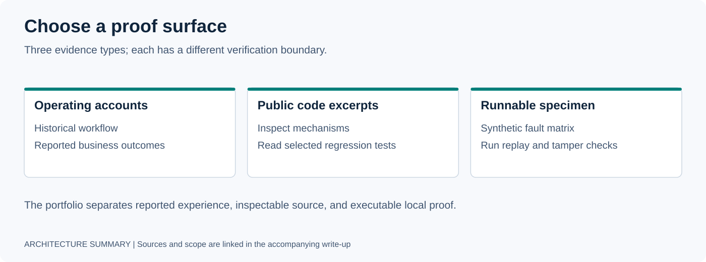

# Public Evidence Guide

This folder contains author-written summaries and one illustrative JSON example supporting the portfolio's engineering accounts. The filenames use “receipt,” but these artifacts are **not signed execution receipts, independent audits, or live service checks**.

Start with the artifact closest to the claim you want to inspect:

| Artifact | What it documents | What it does not establish |
|---|---|---|
| [VSAI evaluation summary](vsai_eval_summary.md) | Reported 95.5%→100% cold-set accuracy after prefix normalization, a local Ollama evaluation path, and weaker adversarial results | Reproducible raw evaluation output, live-call accuracy, latency, fallback behavior, or billing savings |
| [Local inference cost model](local_inference_cost_model.md) | Workload placement and assumptions behind local execution on owned hardware | Metered savings, a cloud invoice comparison, total operating cost, or current routing across every workload |
| [n8n inventory](n8n_inventory_redacted.md) | Workflow categories, triggers, and described reliability/approval patterns | Exported implementations, a verified workflow count, execution logs, or current deployment health |
| [Score example](score_receipt_example.json) | An illustrative WARM-tier scoring payload and routing metadata | A signed scoring event, formula implementation, actual outreach, or business outcome |
| [Security sweep summary](security_sweep_redacted.md) | Described checks, incident lessons, and hardening methods | Raw tool output, an independent security assessment, or current control coverage |

These summaries describe particular workloads and configurations. For example, the VSAI classifier summary specifies Ollama, while the cost model associates MLX with conversation-engine inference. Their descriptions should not be combined into a universal route or treated as a current stack inventory.

For executable evidence, start with the [public Wind Tunnel specimen](../specimens/agent-runtime-wind-tunnel/). It is a synthetic local experiment with its own tests and evidence verifier; it does not validate the business metrics in the case studies. The [portfolio project map](../README.md#public-project-map) links other code surfaces and their scope.

Public artifacts omit customer records, credentials, private endpoints, proprietary signal-to-point mappings, and internal infrastructure identifiers.

[Portfolio](../README.md) · [Case studies](../CASE_STUDIES.md) · [Resume](../RESUME.md)
