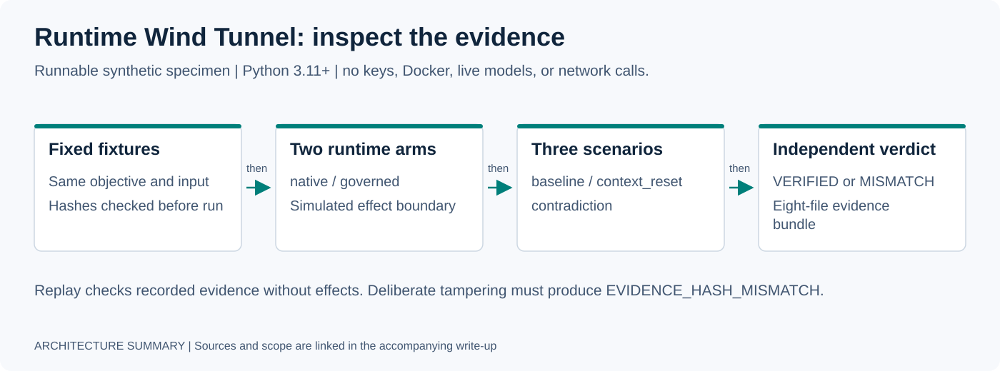

# Agent Runtime Wind Tunnel — Public Specimen

A deterministic fault-injection and verification harness for agent runtimes.

This is a deliberately small public proof of a larger Wind Tunnel design: **hold the workload constant, inject a declared fault, keep authorization separate from execution, and let an independent verifier adjudicate the evidence.**

No API keys. No network calls. No Docker. No live LLM. Python standard library only.



## Run the proof

Requires Python 3.11+. From a fresh checkout:

```bash
git clone https://github.com/gabeacosta/ai-portfolio.git
cd ai-portfolio/specimens/agent-runtime-wind-tunnel
python3 -m unittest discover -s tests -v
python3 -m wind_tunnel demo
python3 -m wind_tunnel tamper
```

If this directory is already open, run only the three Python commands. The Makefile offers equivalent `test`, `demo`, and `tamper` shortcuts.

Expected matrix:

```text
scenario           native       governed
baseline           VERIFIED     VERIFIED
context_reset      VERIFIED     VERIFIED
contradiction      MISMATCH     MISMATCH
```

The tamper demonstration deliberately corrupts recorded evidence. Verification-only replay reports `FAILED / EVIDENCE_HASH_MISMATCH` with **zero simulated replay effects**. The demonstration itself exits 0 when that expected rejection is detected; direct verification of an altered bundle exits 1.

**Audit check, 2026-10-30:** all 14 tests passed and all six matrix verdicts matched expectations. See the [portfolio audit](../../docs/PORTFOLIO_AUDIT.md) for scope.

## What this proves

- Native and governed arms receive the same objective and immutable fixture snapshots.
- `context_reset` destroys real transient runtime state after execution; verification resumes from durable state.
- Governed runs cross a deterministic capability gate before the simulated external effect and emit linked receipts.
- Native runs do not fabricate governance receipts.
- Contradictory verifier evidence produces `MISMATCH` without mutating canonical specimen truth.
- Every run emits exactly eight evidence artifacts into a new, non-overwritable directory.
- Replay verifies recorded hashes/receipt linkage with `side_effects_enabled=false` and `provider_calls=0`.

## What this does not prove

This is **implemented + tested public specimen**, not a production runtime, live-provider benchmark, private Runtime Lab release, or production Veynit policy service.

## Runtime

```text
RECEIVED -> PLANNED -> EXECUTING -> VERIFYING -> COMPLETE
```

The checked-in provider output is deterministic. The provider is not the subject under test; the runtime contract around it is.

## Matrix contract

[`matrix.json`](matrix.json) predeclares all six cells and pins SHA-256 hashes for both fixtures. The controller rejects unknown arms/scenarios or fixture drift.

Only `arm` and `scenario` vary.

### Baseline

Records an explicit `fault.none` boundary.

### Context reset

After `EXECUTING`, the controller sets the runtime's transient context to `None`. The next stage must reconstruct the objective/recommendation from durable state and records `recovered_from_durable=true`.

### Contradiction

Injects a verifier-only objective hash conflict. The specimen's canonical objective is unchanged, so the independent verdict is:

```text
MISMATCH / DECLARED_EVIDENCE_CONTRADICTION
```

## Native vs governed

```text
                 ┌──── native ───────────────────┐
specimen action ─┤                               ├─► simulated effect
                 └──── governed ─► policy gate ──┘
                                      │
                                 linked receipts
```

The public gate allows exactly one capability: `write:recommendation`. It exists to prove the authority boundary, not to expose private governance logic.

## Evidence bundle

Each successful run writes exactly:

```text
manifest.json
normalized_events.jsonl
receipts.jsonl
faults.jsonl
verdict.json
scorecard.json
summary.md
replay.json
```

The output directory must not already exist. CLI demo output is illustrative; inspect the generated bundles and verifier results for evidence of a particular run.

## Run one cell

```bash
mkdir -p /tmp/wind-tunnel
python3 -m wind_tunnel run governed context_reset /tmp/wind-tunnel/run-001
python3 -m wind_tunnel verify /tmp/wind-tunnel/run-001
```

## Design rules

- Provider completion is not acceptance.
- Model output is not authorization.
- The harness cannot silently change the workload between arms.
- Fault injection cannot silently mutate canonical specimen truth.
- Missing/invalid evidence cannot become a pass.
- Replay cannot emit external effects.
- Existing evidence fails closed rather than being overwritten.

## Why this exists

The goal is not to open-source the private runtime. The goal is to make the engineering claim independently testable by a reviewer in minutes.
